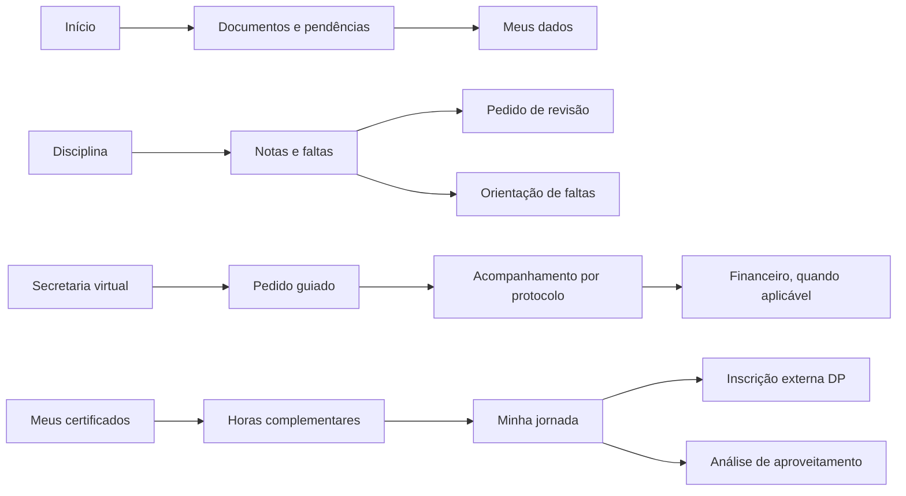

# Do portal organizado pela instituição ao portal orientado pelo aluno

Inspeção realizada em 20/10/2026, com a conta de teste autorizada. O trabalho combina observação do portal, avaliação heurística e prototipação. Não houve entrevistas, teste com alunos ou acesso a métricas de uso. As hipóteses abaixo precisam ser validadas antes de serem apresentadas como melhorias comprovadas de CX.

Revisão 2: após a avaliação do usuário, a execução passou a clonar o portal real antes de reorganizá-lo. A análise e as referências abaixo continuam como fundamento; a implementação atual e seus limites estão em REANALISE-E-CLONAGEM.md. Mudanças de regra e consolidação de ofertas permanecem hipóteses, não alterações silenciosas na cópia.

## A decisão central

O aluno não deveria precisar descobrir qual setor da faculdade resolve sua necessidade. A navegação deve aproximar a informação da ação: uma nota leva à revisão, uma falta à orientação adequada, uma dependência à inscrição e um pedido ao seu acompanhamento. A estrutura acadêmica continua existindo nos sistemas, mas deixa de ser a principal exigência cognitiva da interface.

O portal observado já apresenta uma home com próxima aula, situação acadêmica, progresso, disciplinas, notificações e mural. Há estados vazios explicativos, atalhos para AVA, animações e componentes consistentes. A proposta aproveita esses avanços e reorganiza as relações entre as áreas.

## O que foi observado e o que mudou

| Evidência na inspeção                                                                                              | Implicação para um ingressante                                               | Decisão no protótipo                                                                           | Prioridade |
| ------------------------------------------------------------------------------------------------------------------ | ---------------------------------------------------------------------------- | ---------------------------------------------------------------------------------------------- | ---------- |
| Notas, horas, documentos, certificados e colação aparecem como seções do perfil                                    | “Meu perfil” reúne assuntos de naturezas diferentes                          | Estudos em Minha vida acadêmica; documentos pessoais em Meus dados; colação na secretaria      | P0         |
| Solicitação de serviços convive com vários destinos de serviço no menu                                             | É necessário aprender a classificação interna                                | Secretaria com home própria, catálogo, acompanhamento e caminhos especializados                | P0         |
| Catálogo tem 40 serviços, códigos CSA e nomes extensos                                                             | O aluno pode não conhecer o nome formal                                      | Nome por intenção, busca sem acentos, manutenção do código e do nome original como referência  | P0         |
| Jornada informa que DP/adaptação não entra automaticamente na matrícula                                            | A orientação fica distante da ação                                           | Link de inscrição junto à disciplina no cenário de dependência e acesso ao edital              | P0         |
| Documentos são anexos de matrícula; declarações são emitidas pela instituição                                      | “Documento” pode significar duas ações opostas                               | Separar “Meus documentos” de “Pedir declarações”, com links de esclarecimento entre ambos      | P0         |
| Notas e faltas oferecem detalhes e links para AVA                                                                  | A informação não encerra a necessidade do aluno                              | Revisão de nota e compensação preservam a disciplina de origem                                 | P0         |
| Há caminhos distintos para compensação de ausência e prova substitutiva                                            | A semelhança dos assuntos pode gerar pedido inadequado                       | Explicação e link para o procedimento correspondente antes do formulário                       | P0         |
| A conta de teste mostra solicitações com diferentes resultados                                                     | O aluno precisa reconhecer sua etapa atual                                   | Linha de acompanhamento, protocolo, resultado e ação seguinte                                  | P0         |
| As telas de estágio e colação têm restrições por grade/etapa                                                       | “Indisponível” sem motivo pode parecer erro                                  | Explicar por que ainda não se aplica e oferecer orientação                                     | P1         |
| A home e os horários mostram ocorrências repetidas de comunicação escrita; alguns nomes de docente são provisórios | Repetições e termos de cadastro podem parecer disciplinas adicionais ou erro | Preservar ocorrências na cópia; confirmar identificadores oficiais antes de consolidar ofertas | P1         |
| A jornada tem 8 períodos e 44 disciplinas                                                                          | O curso precisa ser compreendido como percurso                               | Todos os períodos expansíveis, com carga horária e detalhe navegável                           | P1         |
| Financeiro possui extrato, bolsa, cobranças e ajustes em caminhos diferentes                                       | Uma pendência requer contexto e possibilidade de resolução                   | Home financeira, extrato, responsáveis e documentos conectados à secretaria                    | P1         |
| Recursos como biblioteca, monitoria, CPIC e AVA são externos                                                       | A troca de sistema pode parecer abandono do portal                           | Rótulo de abertura externa e orientação no contexto                                            | P1         |
| A experiência precisa funcionar prioritariamente no celular, segundo o briefing                                    | Reduzir o desktop não resolve a navegação                                    | Composição móvel observada, menu em gaveta, listas e expansões; versão Conectada comparável    | P0         |

As repetições observadas não provam duplicidade na base acadêmica. A consolidação é uma hipótese de apresentação; a integração deve usar identificadores oficiais e preservar diferenças reais entre turmas e ofertas.

## Estrutura orientada por perguntas

- **Início:** o que preciso fazer hoje e o que precisa de mim?
- **Minha vida acadêmica:** como estou nos estudos e qual é meu próximo passo?
- **Secretaria virtual:** como resolvo isso e como acompanho o retorno?
- **Meu financeiro:** o que preciso pagar, conferir ou organizar?
- **Meus dados:** quais informações e documentos dizem respeito a mim?

Avisos, calendário, mural e ajuda são transversais. Uma informação pode aparecer em mais de um contexto, mas aponta para o mesmo destino responsável. Isso evita criar versões concorrentes do mesmo serviço.

## Fundamentos consultados e aplicação

### Reconhecer é mais fácil do que lembrar

A pesquisa de usabilidade sintetizada pela Nielsen Norman Group recomenda reduzir a dependência de memória, tornando opções e contexto reconhecíveis. Aplicação: “Mudar de turno”, “Preciso de um atestado” e “Ver minhas notas” aparecem antes dos códigos administrativos. Isso fundamenta a hipótese de menor esforço, mas não mede o resultado no Anchieta. [Recognition and Recall — NN/g](https://www.nngroup.com/articles/recognition-and-recall/).

### Progresso precisa mostrar o que falta

O GOV.UK Design System descreve listas de tarefas para situações em que pessoas precisam reconhecer o que fizeram e o que ainda falta, com liberdade de sequência. Aplicação: documentos de matrícula funcionam como itens independentes; solicitações que exigem ordem usam etapas e revisão. A lista de tarefas não substitui a simplificação do serviço. [Task list — GOV.UK](https://design-system.service.gov.uk/components/task-list/).

### Mobile muda a estrutura da informação

A orientação da NN/g sobre tabelas móveis enfatiza as tarefas que precisam ser preservadas e o agrupamento das informações. Aplicação: notas e faltas apresentam resumo e expansão por disciplina; no celular, a leitura deixa de exigir uma tabela larga. O dado essencial continua próximo da identificação da disciplina. [Mobile Tables — NN/g](https://www.nngroup.com/articles/mobile-tables/).

### Acessibilidade tem requisitos verificáveis

A WCAG 2.2 define critérios de refluxo, contraste, foco e tamanho dos alvos. A proposta verifica ausência de overflow a 320 px, oferece foco visível, movimento reduzido, rotulagem e controles principais com área confortável. O mínimo AA de alvo tem regras e exceções próprias; “usar 44 px” não equivale, isoladamente, a cumprir toda a WCAG. [Reflow — W3C](https://www.w3.org/WAI/WCAG22/Understanding/reflow.html), [Target Size — W3C](https://www.w3.org/WAI/WCAG22/Understanding/target-size-minimum.html), [WCAG 2.2](https://www.w3.org/TR/WCAG22/).

### A experiência digital do estudante precisa ser pesquisada

O relatório Jisc 2024/25 reúne evidências sobre experiência digital no ensino superior britânico. É uma referência setorial para incorporar a perspectiva do estudante às decisões. Não é uma amostra dos alunos do Anchieta, nem demonstra que esta proposta terá o mesmo comportamento. A aplicação aqui é metodológica: medir a experiência real antes e depois. [Jisc — Student Digital Experience 2024/25](https://digitalinsights.jisc.ac.uk/reports-and-briefings/our-reports/2024-25-uk-higher-education-students-digital-experience-insights-survey-findings/).

## Conexões que fazem a experiência conversar

## O que medir com alunos

Começar com ingressantes em seus próprios celulares, incluindo pessoas com baixa familiaridade digital e diferentes necessidades de acessibilidade. Usar dados fictícios e observar tarefas, sem ensinar o caminho primeiro.

| Tarefa de teste                                   | O que observar                                            |
| ------------------------------------------------- | --------------------------------------------------------- |
| Encontrar a próxima aula e entrar no AVA          | Primeira escolha, tempo e dúvidas sobre a saída do portal |
| Entregar um documento e acompanhar a análise      | Diferença percebida entre envio e emissão                 |
| Pedir um atestado de matrícula                    | Encontrabilidade pelo vocabulário do aluno                |
| Entender uma falta e escolher o procedimento      | Confusão entre compensação e substitutiva                 |
| Encontrar uma DP e descobrir como se inscrever    | Compreensão de oferta, elegibilidade e sistema externo    |
| Acompanhar um protocolo e localizar seu resultado | Clareza das etapas e necessidade de contato               |
| Conferir uma cobrança e o responsável             | Compreensão de valor, vencimento e ação disponível        |
| Encontrar horas restantes e certificados          | Compreensão de reconhecimento e registro da atividade     |

Registrar sucesso sem ajuda, erros de caminho, desistência, tempo por tarefa e uma pergunta de facilidade após cada tarefa. Definir metas com base no teste do portal atual; não inventar uma redução percentual antes da medição. Complementar com logs de busca sem resultado, retornos à navegação, volume de contatos por assunto e reenvios de documentos.

## Implantação em etapas

1. Validar a arquitetura com alunos e alinhar nomes com secretaria, acadêmico e financeiro.
2. Confirmar regras por serviço: público elegível, custo, prazo, anexos, cancelamento, assinatura e tratamento de erro.
3. Integrar autenticação, vínculos acadêmicos, identificadores de disciplina e protocolos oficiais.
4. Pilotar os caminhos de maior demanda com medição antes/depois e canal de recuperação.
5. Ampliar por famílias de serviço, com revisão de acessibilidade e monitoramento.

O frontend entregue permite essa discussão de forma concreta. A implantação ainda exige os contratos de integração e as validações institucionais descritas em LIMITES-E-INTEGRACAO.md.
